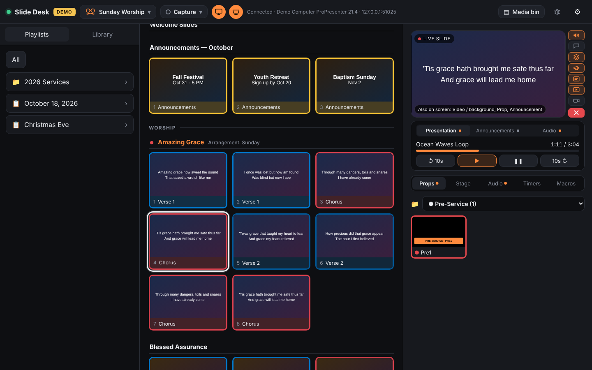

# Slide Desk 1.2.1 — control ProPresenter from another computer



**Download:** click the green **Code** button above → **Download ZIP**, unzip it, and follow *Setup* below. Or try it first with the **Start Demo** files (no ProPresenter needed).

A browser-based control screen for ProPresenter 7, laid out like ProPresenter itself. Open it on any Mac or Windows computer on your network — no iPad needed.

**Layout**
- **Left — Playlists & Library:** browse folders, playlists and all your libraries. The Library search box searches **every library at once** (open a library to search just that one). Click an item to **preview** its slides in the middle without going live.
- **Middle — Slides:** big slide thumbnails. Each slide has a border in its group's color (Verse, Chorus, etc.), like ProPresenter; the live slide gets a white outline. Click a slide to put it live. While previewing something else, the live presentation keeps running; "Back to live" returns to it.
- **Right — Live:** a picture of the live slide straight from ProPresenter (click for full screen), with the clear buttons down its side, media playback under it, and slide notes (in yellow) when the live slide has any. Below that, one box with buttons like ProPresenter's: **Props** (a folder dropdown at the top picks which of ProPresenter's prop collections to show, or All; ● marks a folder with a prop on screen; click a prop to show it, click again to take it off), **Stage** (stage message and which layout each stage screen shows), **Audio** (click a song to play it), **Timers** and **Macros** (with the same folder dropdown). The chosen folder is remembered.
- **Looks:** the mustache-and-glasses button in the top bar shows the current Look; click it to switch Looks, like in ProPresenter. **Edit Looks…** at the bottom of the list opens a popup to **add** a Look (starts as a copy of the selected one), **edit** one (rename it, turn each screen on or off, and choose which layers each screen shows: Audio, Messages, Props, Announcements, Slide, Media, Live, and pick a **mask** for each screen from your ProPresenter masks, with a small picture), **delete** one (asks first; the current Look can't be deleted), or switch to it. Each change is checked against ProPresenter after saving.
- **Audience / Stage:** two round buttons in the top bar (monitor = Audience, stage = Stage), like ProPresenter's, show whether the audience screens and stage screens are on (orange) or off (red, crossed out). Click to turn them on or off.
- **Capture:** the button next to Looks shows whether ProPresenter is recording or streaming (red, with the running time). Click it to Start or Stop capture (Stop asks first) and to see the current capture setup. Destinations, encoders and stream keys are still set up in ProPresenter.
- **Stage display:** pick which stage layout each stage screen shows (with a small picture of each layout).
- **Macros** are grouped by their folders like in ProPresenter, when your ProPresenter version shares them.
- **Clear buttons** run down the side of the live preview: in ProPresenter's order: Audio, Messages, Props, Announcements, Slide, Media, Live (video input), and Clear All (red) at the bottom. A button lights up orange when that layer has something on screen; hover for its name. In **⚙︎ Settings → Clear buttons** you can tick which ones show (saved on each computer).
- **Media playback** (under the live preview): one bar, like ProPresenter's transport. Switch between **Presentation, Announcements and Audio**; a dot on each tab shows what's loaded (orange = playing), and Play or Pause lights up to show which state it's in. See the name and time, use back 10s / play / pause / forward 10s, and click or drag along the progress bar to scrub through a song or video (it jumps there when you let go).
- **Media bin** (button in the top bar): opens a drawer along the bottom of the playlists and slides, like ProPresenter's bin. **Media** and **Live Inputs** tabs (Live Inputs shows your cameras / capture / NDI inputs set up in ProPresenter: click one to put it live; the Video Input clear button takes it off), a playlist picker (folders included) and search. Click an item to play it; what's playing has an orange outline. Big playlists load fully (ProPresenter sends 100 items at a time; the remote asks for the rest).
- Change slides by clicking them, or with → / ← / spacebar / Page Up-Down (works with a presentation clicker).
- **↓ / ↑ pick the next / previous playlist item** without changing what's on screen (it gets a dashed outline and an "Up next" tag); the next → (or Space / clicker) puts its first slide live. Esc cancels.
- **Hotkeys:** press **?** to see them all. Defaults: **F1** Clear All, **F2** Slide, **F3** Media, **F4** Audio, **F5** Props, **F6** Messages, **F7** Announcements, **F8** Live; **Home/End** first/last slide; **Song sections** have their own keys, matching our ProPresenter group hotkeys: **I** Intro · **A S D F G** Verse 1–5 · **P** Pre-Chorus · **C X Z** Chorus 1–3 · **B N M** Bridge 1–3 · **T** Tag · **E** Ending · **O** Outro (Post-Chorus, Interlude and Turnaround can be given keys too). A key jumps to the next time that section comes up in the live song, matched by the group names in ProPresenter ("V1" counts as Verse 1, a plain "Chorus" as Chorus 1). Media play/pause and skip, the media bin and Report a problem can also get keys. Operators and Admins can change any of them in **⚙︎ Settings → Hotkeys** (saved per computer). On Mac laptops F-keys may need the fn key.
- **Continuous** (switch at the top of the slides, on by default): like ProPresenter, the middle shows the **whole playlist in one scroll**: section headers as dividers, each song with its name and arrangement, then its slides. Click any slide of any song to put it live; media items show as a row you click to play. The view follows the live slide as it moves, and pressing Next on the last slide of an item goes on to the next item (skipping headers and hidden items). Big playlists load songs as you scroll. Planning Center plans, and items opened from the Library, show one item at a time. Turn Continuous off to always see one item at a time.

**Playlists** are built and edited in ProPresenter. The remote shows them and plays from them, but doesn't change them (ProPresenter's API resets song arrangements when a playlist is saved from outside, so editing from the remote was removed).

**Instant updates:** the remote asks ProPresenter to tell it the moment something changes (slide, layers, Look, screens, capture, media playback) instead of asking over and over, so changes made in ProPresenter show up right away and the ProPresenter computer does less work. If your ProPresenter version doesn't offer this, or the connection drops, the remote quietly goes back to checking several times a second and tries again. The Terminal window says which one is in use ("Instant updates: ON"), and hovering over the connection text in the top bar shows it too.

**Dark / Light mode:** ⚙︎ Settings → Appearance: Dark, Light, or Match computer (follows the computer's own setting). Saved on each computer.

Several computers can use the remote at once and stay in sync.

## Who can use the remote
Each person signs in with **their own PIN**, and each person has a **level**:

| Level | Can |
|---|---|
| **Viewer** | watch: see the slides and what's live, but change nothing |
| **Slides only** | go to slides and playlist items (Next / Previous, clicking slides, hotkeys) and use the Clear buttons |
| **Operator** | run the service: everything above, plus media, audio, props, macros, timers, stage message and layouts, switching Looks, live inputs and the playback bar |
| **Admin** | everything: also editing Looks, Audience / Stage screens on and off, capture start / stop, the ProPresenter connection, and managing people |

The remote hides what a level can't use, and the helper program refuses it too.

- **First start:** a new install makes an **Admin** with a made-up PIN and shows it in the Slide Desk window every time it starts, until you change it. Sign in with it, then add your team.
- **Signing in:** a computer asks for a PIN once and remembers it. A remote that isn't used for **3 days** asks again (opening it or pressing anything counts as use; just leaving it open doesn't). Settings → Access shows who's signed in, with **Sign out**.
- **One computer at a time:** each person (except Admins) can be signed in on one computer at a time. A PIN never signs anyone out, so nobody can take over someone's remote with their PIN. If that person is already signed in somewhere, the PIN is refused ("This PIN is already in use on another computer"). It works again once they sign out there, an Admin signs them out (Settings → Access → People), or 3 days pass without use. Admins can be signed in on as many computers as they like.
- **The computer running the remote never needs a PIN** (it's always Admin), so you can't lock yourself out.
- **Who's on:** in **⚙︎ Settings → Access → People**, a green dot marks anyone using the remote right now, and **Sign out** is highlighted for anyone signed in on some computer.
- **Managing people:** Admins use **⚙︎ Settings → Access**: add someone (leave the PIN blank to have one made up), change their level, show their PIN, give them a new PIN, sign them out everywhere, or remove them. A new PIN signs that person out on every computer.
- **Wrong PINs:** after 5 wrong tries, that computer waits a minute.
- **Don't want PINs at all?** Remove everyone (Admin last). With nobody added, anyone on the network can use the remote with no PIN.
- **Updating from an earlier version:** the old shared PIN becomes a person called *Admin* with the same PIN. With no PIN before, the remote stays open to everyone until you add someone.

### Commands in the Slide Desk window
The Slide Desk window (the Terminal window on the computer running the remote) takes commands. Type one and press Enter:
- `users` lists everyone, their level and PIN
- `add Sarah operator` adds Sarah and makes up a PIN for her (`add Sarah 2580 operator` to choose it). Levels: `viewer`, `slides`, `operator`, `admin`
- `pin Sarah 2580` gives Sarah a new PIN
- `level Sarah viewer` changes Sarah's level
- `signout Sarah` signs Sarah out everywhere (`signout everyone` for all)
- `remove Sarah` takes Sarah's access away
- `remotes` (or `who`, or `connections`) shows how many remotes are open, who's on them and which computers they're on. The window also notes each one as it opens or closes; one that drops off (like a computer going to sleep) shows as "stopped responding" within a minute
- `help` lists the commands

**Forgot your PIN?** Ask whoever is at the ProPresenter computer to type `users` in the Slide Desk window.

The Slide Desk window also logs who did what ("Sarah  GET /v1/trigger/next"), and problem reports say who sent them. PINs never go into problem reports. This keeps volunteers in their lane on your local network. It isn't bank-level security: the remote uses plain http, so someone determined on the same network could watch a PIN go by.

## Report a problem
Click the **bug** button in the top bar (next to ⚙︎). The remote takes a screenshot of itself first, then asks what happened and what you were trying to do (name and reply email are optional). Along with it go the setup details (remote and ProPresenter versions, Mac/Windows, browser), what was on screen at the time, recent problems on the page, and the last 60 lines of the Terminal log. You can see everything before sending, and untick the screenshot. The PIN and stream keys are never included.
- Every report is saved on the computer running the remote, in the **reports** folder (a readable .txt, the screenshot, and the details), then emailed.
- No internet? It stays in **reports/outbox** and is sent automatically when the computer is back online (checked every few minutes).
- One report a minute, so nobody floods the inbox by accident. Reports from the demo are marked **[DEMO]**.
- If email isn't set up, or sending fails, the remote offers **Copy report** and **Save screenshot** (and **Open in email app** when an address is set).
- Where reports go is set in **report-settings.json**.

## Try it without ProPresenter (demo)
Double-click **Start Demo (Mac).command** or **Start Demo (Windows).bat**. It runs the real remote against a pretend ProPresenter with sample songs, playlists, props, Looks and media, and opens it in your browser at `http://localhost:8090`. Nothing real is controlled, a yellow **DEMO** tag shows in the top bar, and the demo keeps its own settings (your real setup isn't touched). Needs Node.js, like the real remote. Close the window to stop it.

## Updating from Pro Remote
Slide Desk used to be called **Pro Remote**. It was renamed so it isn't confused with Renewed Vision's own *ProPresenter Remote* app. Nothing else changed.
- **Mac:** install Slide Desk from the new .dmg, then drag the old **Pro Remote** app from Applications to the Trash. The first time Slide Desk opens, it moves your settings, people and PINs over from Pro Remote automatically.
- **Windows:** replace the folder with the new one, then double-click **Install Slide Desk (Windows).bat** once. It removes the old Pro Remote shortcuts and adds Slide Desk ones. If your settings were in the old folder, copy its `config.json` (and `config-sessions.json`) into the new folder first.
- Team computers that saved the remote as an app: remove the old *Pro Remote* one and add it again (it'll be called Slide Desk).
- The address and port (4316) don't change, so bookmarks keep working.

## Setup (one time, about 5 minutes)

1. **Turn on ProPresenter's network API.** ProPresenter → Settings → **Network** → check **Enable Network**. Note the port shown (often 1025, 50001, etc.). Requires ProPresenter 7.9 or newer.
2. **Install Node.js** (free) on the ProPresenter computer from https://nodejs.org — choose the LTS version.
3. **Install and start the remote** on the ProPresenter computer:
   - **Mac:** open the **Slide Desk .dmg** disk image (from the project's Releases page) and drag **Slide Desk** onto **Applications** in the window that appears (and onto the Dock if you like), then open it. The first time, macOS says it can't verify the app: click Done, then System Settings → Privacy & Security → **Open Anyway**. Slide Desk opens a Terminal window that runs the remote. Its settings are kept in *~/Library/Application Support/Slide Desk*, so updating the app keeps them.
   - **Windows:** put this folder somewhere permanent (for example *Documents*), then double-click **Install Slide Desk (Windows).bat** once. It adds **Slide Desk** with its icon to the Start menu and the desktop (right-click it in Start → Pin to taskbar). Open it from there from now on.
   - You can still start it the old way with **Start Slide Desk (Mac).command** / **Start Slide Desk (Windows).bat**.
   The window shows an address like `http://192.168.1.50:4316`. Keep that window open while you use the remote.
4. **On the computer you'll control from**, open that address in Chrome, Edge or Safari (same network as ProPresenter). Press F11 (Windows) or Ctrl+Cmd+F (Mac) for full screen.
5. Tap **⚙︎** and enter ProPresenter's port from step 1 (leave the IP as `127.0.0.1` if the remote runs on the ProPresenter computer). The dot turns green when connected.
6. **Sign in and add your team:** the Slide Desk window shows the Admin PIN. Sign in with it on your control computer, then open **⚙︎ Settings → Access** to change your PIN and add people. (Skip this if you don't want PINs; see *Who can use the remote*.)

### Add the remote to your team's computers
The computers you control from don't install anything; they just open the address. To give them a **Slide Desk** icon that opens in its own window:
- **Safari (Mac):** open the remote, then **File → Add to Dock**.
- **Chrome / Edge (Mac or Windows):** open the remote, then **⋮ → Cast, save and share → Create shortcut…**, tick **Open as window**, and click Create. It appears in Applications / the Start menu.

## Planning Center plans
ProPresenter doesn't share a Planning Center plan's item list with other apps. Opening a plan in the remote shows the item currently selected in ProPresenter; click an item in the plan **in ProPresenter** and its slides (with that item's arrangement) appear in the middle of the remote, ready to go live. For the full list in the remote, drag the plan's items into a regular playlist.

## How it fits together

```
 Control computer's browser ──►  Slide Desk (this folder, port 4316)  ──►  ProPresenter API
```
Browsers aren't allowed to talk to ProPresenter directly from a web page, so the small helper in this folder (`server.js`) serves the HTML remote and passes its commands along. It has no dependencies and can run on the ProPresenter machine or any other computer on the network (just point ⚙︎ at ProPresenter's IP).

## Troubleshooting
- **Mac says "permission denied" or the .command file opens as text:** in Terminal type `chmod +x ` (with a space), drag the .command file onto the window, press Enter, then double-click it again.
- **Red dot / "Can't reach ProPresenter":** check Enable Network is on, the port in ⚙︎ matches, and ProPresenter is open.
- **The other computer can't open the page:** both computers must be on the same network; allow Node through the firewall on the computer running the remote (Windows asks the first time, Mac may too).
- **Port 4316 already used:** edit `remotePort` in `config.json` (created after the first save) and restart.
- Settings are saved in `config.json` next to `server.js`.

## License
Created by Gavin Peppers, with Crossroads Community Church (Athens, GA) as a contributor.

Slide Desk is free, open-source software under the **GNU General Public License v3** (or any later version); see `LICENSE.txt` and `COPYRIGHT.txt`. In short: anyone may use, copy, change and share it, and may even charge for copies, but anyone who shares it, changed or not, must share the source code under the same GPL license and keep the copyright notices. No one can turn it into a closed, proprietary product. It comes with no warranty.

## Disclaimer
Slide Desk is an independent, open-source project. It is not made, supported or endorsed by Renewed Vision, and is not affiliated with or in partnership with them. ProPresenter is a trademark of Renewed Vision. Please don't contact Renewed Vision support about Slide Desk.
